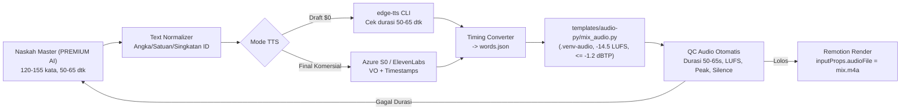

# Arsitektur TTS & Pipeline Audio — Kok Iso Yo?

Dokumen ini adalah rancangan arsitektur **Text-to-Speech (TTS) multi-provider** dan integrasi audio end-to-end untuk pipeline produksi otomatis *Kok Iso Yo?* (target awal hingga 3 YouTube Shorts/hari, durasi 50–65 detik per video).

> **Status:** Tahap Analisis & Perencanaan (belum ada pembelian paket, registrasi API berbayar, atau perubahan kode produksi).

---

## 1. Ringkasan Kondisi Saat Ini (Basis Audit)

1. **TTS CLI di VPS:** Terpasang `edge-tts 7.3.1` (`/home/vps-ubuntu2/.local/bin/edge-tts`) dengan voice Bahasa Indonesia `id-ID-ArdiNeural` (pria) dan `id-ID-GadisNeural` (wanita). Engine TTS lokal offline murni (`piper`, `kokoro`, `espeak-ng`) tidak terpasang.
2. **Belum Ada Adapter TTS Terprogram:** Belum ada modul di `services/` yang mengubah naskah menjadi file audio + timing otomatis. Episode sebelumnya menggunakan file MP3 statis atau upload manual lewat `/api/projects/:slug/audio`.
3. **Pipeline Mixing & Mastering Offline Sudah Matang:** [`templates/audio-py/mix_audio.py`](../templates/audio-py/mix_audio.py) (berjalan di `.venv-audio/` dengan `numpy` + `scipy` + `ffmpeg`) sudah menyediakan:
   - Dekode otomatis `.mp3`/`.wav`/`.m4a` ke `48 kHz` 16-bit PCM WAV (`ensure_wav_48k`).
   - Normalisasi stem VO, music bed prosedural (`curious_doc`, `march_tension`, `wonder_calm`), ambience, dan SFX berbasis `shots.json`.
   - Auto-ducking berbasis `words.json` (mendukung format `[{"s", "e", "w"}]`, `[{"start", "end", "text"}]`, format Whisper `words`/`segments`, serta fallback VAD envelope otomatis bila `words.json` kosong).
   - Mastering BS.1770-4 **`-14.5 LUFS`**, True Peak **$\le -1.2\text{ dBTP}$**, cross-check `ffmpeg ebur128`, dan output siap Remotion `mix.m4a` (`AAC 192 kbps`).
4. **Celah Integrasi:** Saat ini komposisi Remotion masih memutar VO mentah langsung (`.mp3` mono `44.1 kHz`), belum memanggil `TTS → mix_audio.py → mix.m4a` secara otomatis, dan batas kuota default di `dashboard/data/ai_quota.json` (`120.000` karakter/bulan) mepet jika terjadi revisi naskah.

---

## 2. Estimasi Kebutuhan Kuota (Target 3 Shorts/Hari × 50–65 Detik)

Untuk narasi Bahasa Indonesia bergaya *edutainment* cepat dan jelas (~130–155 kata/menit):

| Metrik | Per Video (50–65 dtk) | Per Hari (3 Video) | Per Bulan (90 Video) |
|---|---:|---:|---:|
| **Jumlah Kata** | 120 – 155 kata | 360 – 465 kata | 10.800 – 13.950 kata |
| **Karakter Bersih (Final)** | 850 – 1.050 karakter | 2.550 – 3.150 karakter | 76.500 – 94.500 karakter |
| **Karakter Kotor (+25–30% revisi/retake)** | ~1.150 – 1.350 karakter | ~3.450 – 4.050 karakter | **~100.000 – 125.000 karakter** |
| **Durasi Audio Final** | ~1 menit | ~3 menit | ~90 menit |

**Implikasi Kuota:**
- Jika draft/uji durasi diarahkan ke jalur gratis (`edge-tts`), maka pemakaian API komersial berbayar **hanya terjadi 1× per video final** (~76.500 – 95.000 karakter/bulan, aman dengan buffer ~110.000 karakter/bulan).
- Batas `ttsCharsPerMonth` di dashboard sebaiknya disesuaikan ke `150.000` karakter/bulan (hanya pada tahap implementasi nanti).

---

## 3. Evaluasi & Perbandingan Provider TTS

> **Catatan Verifikasi:** Angka tarif & ketentuan lisensi di bawah berasal dari dokumentasi publik terbaru dan **wajib diverifikasi ulang** pada halaman pricing/Product Terms resmi masing-masing vendor sebelum berlangganan atau aktivasi produksi.

| Kriteria | Edge-TTS (`edge-tts 7.3.1`, VPS) | Azure AI Speech — Standard Neural (S0) | ElevenLabs (Creator / Starter / API) |
|---|---|---|---|
| **Peran Ideal** | **DRAFT & PREVIEW** (uji tempo 50–65 dtk) | **PRODUKSI FINAL (Biaya Terendah + Resmi)** | **PRODUKSI FINAL (Premium / Ekspresif)** |
| **Estimasi Biaya @ 100k–125k kar/bln** | **$0** | **~$1,50 – $1,88 / bulan** (`$15 / 1M karakter` S0 Pay-As-You-Go; F0 gratis 500k kar/bln khusus uji coba) | **~$22 / bulan** (Creator: 121k kredit; Starter `$6` hanya 30k kredit — tidak cukup untuk 90 video/bln; Flash v2.5 lebih hemat kredit namun aksen ID perlu diuji vs Multilingual v2) |
| **Kualitas Bahasa Indonesia** | Baik & jelas (`id-ID-ArdiNeural`, `id-ID-GadisNeural`), tapi dinamika emosi terbatas | Identik dengan Edge-TTS + kontrol penuh **SSML** (`prosody`, `break`, `emphasis`, pengucapan istilah) | Sangat natural & ekspresif (Multilingual v2), kuat untuk hook 0–2 detik & storytelling, mendukung Voice Cloning |
| **Konsistensi Voice** | Tinggi (voice ID tetap), tapi rentan throttling/perubahan protokol | **Sangat tinggi** + SLA resmi enterprise | **Sangat tinggi** (fixed `voice_id` + parameter `stability`/`similarity_boost`) |
| **Latency (60 dtk audio)** | ~2–5 detik (HTTP/WS tidak resmi) | ~1–3 detik (REST/SDK resmi region Asia Tenggara/Singapore) | ~2–6 detik (Multilingual v2) / ~1–2 detik (Flash v2.5) |
| **Output Timing (`words.json`)** | Ya (`--write-subtitles` VTT/SRT → konversi ke `words.json`) | Ya (native `WordBoundary` event via SSML/SDK atau estimasi/alignment) | Ya (endpoint `/text-to-speech/:voice_id/with-timestamps` mengembalikan alignment karakter → kata) |
| **Lisensi Komersial** | **Tidak ada lisensi komersial resmi** (endpoint consumer tidak resmi) — *jangan untuk rilis monetisasi* | **Lisensi komersial resmi** pada tier **Paid S0** (verifikasi Microsoft Product Terms; F0 tidak disarankan untuk monetisasi) | **Lisensi komersial penuh** mulai paket berbayar **Starter ke atas** (Free plan non-komersial) |
| **Kemudahan Integrasi** | CLI sudah terpasang di VPS | Mudah via REST API (pure Node `fetch`, 0 npm dependency baru) | Mudah via REST API (pure Node `fetch`, 0 npm dependency baru) |

### Rekomendasi Keputusan Provider
1. **Jangan lock-in ke satu vendor.** Bangun **Adapter TTS Multi-Provider** berbasis environment variable (`TTS_PROVIDER`) dengan pola identik seperti `services/ai-gateway/`.
2. **Strategi 2-Mode (Hemat Biaya + Aman Komersial):**
   - **Mode `draft` (`TTS_DRAFT_PROVIDER=edge_tts`):** Dipakai saat iterasi naskah & pengecekan apakah durasi aktual VO masuk jendela **50–65 detik** (biaya **$0**).
   - **Mode `final` (`TTS_FINAL_PROVIDER=azure_speech` sebagai default biaya rendah, atau `elevenlabs` jika kanal ingin naik kelas ke suara lebih ekspresif):** Dipakai **hanya setelah naskah lolos QC editorial & durasi**.
3. **Alasan Azure AI Speech (S0) unggul sebagai kandidat default awal produksi:**
   - Biaya ~**$1,5–$2/bulan** untuk 90 video (lebih dari 10× lebih murah dibanding ElevenLabs Creator `$22/bulan`),
   - Lisensi komersial resmi + SLA jelas,
   - Mendukung **SSML** sehingga intonasi hook, jeda dramatis (`<break time="250ms"/>`), dan pelafalan istilah sains/asing jauh lebih rapi dibanding `edge-tts` polos,
   - Transisi mulus ke **ElevenLabs** kapan saja cukup dengan mengganti `TTS_FINAL_PROVIDER=elevenlabs` di `.env` jika nanti metrik retensi menunjukkan kebutuhan suara lebih ekspresif.

---

## 4. Rancangan Adapter TTS (Env-Swappable)

Struktur modul yang diusulkan pada tahap implementasi nanti (terisolasi di `services/tts-gateway/`, 0 dependency npm eksternal):

```text
services/tts-gateway/
├── config.mjs              # Loader env + validasi non-secret
├── errors.mjs              # Typed errors (TTSConfigError, TTSAuthError, TTSTimeoutError, ...)
├── textNormalizer.mjs      # Normalisasi angka, satuan (CO2, O2, km/jam), singkatan ID sebelum TTS
├── timingConverter.mjs     # Konversi VTT/SRT / WordBoundary / ElevenLabs char-timestamps -> words.json
├── edgeTtsAdapter.mjs      # Jalur DRAFT (CLI `edge-tts` + `--write-subtitles`)
├── azureSpeechAdapter.mjs  # Jalur FINAL hemat (REST Azure Speech S0 + SSML)
├── elevenLabsAdapter.mjs   # Jalur FINAL premium (REST ElevenLabs + `/with-timestamps`)
├── router.mjs              # 2-mode router (`draft` vs `final`) + fallback terkontrol
├── index.mjs               # Facade `createTTSRouter()`
└── ttsGateway.test.mjs     # Unit & mock HTTP/CLI tests
```

### Kontrak Interface Seragam (Semua Provider)
```js
const result = await ttsRouter.synthesize({
  mode: "draft" | "final",          // default "draft" saat preview, "final" untuk render master
  text: scriptData.narrationScript, // teks narasi final Bahasa Indonesia
  outputDir: jobDir,                // mis. out/pipeline/<jobId>/audio/
  voiceId: undefined,               // opsional override; default dari env
  speakingRate: "+0%",              // opsional penyesuaian tempo
  dryRun: false,
});
// Return:
// {
//   provider: "edge_tts" | "azure_speech" | "elevenlabs",
//   mode: "draft" | "final",
//   voiceId: "...",
//   audioPath: ".../voiceover_raw.mp3",
//   wordsPath: ".../words.json",     // format [{"s": 0.12, "e": 0.45, "w": "Kata"}]
//   durationSec: 57.42,
//   charCount: 942,
//   withinTargetWindow: true,        // true jika 50 <= durationSec <= 65
// }
```

### Environment Variables (Zero Code Change Saat Ganti Provider)
```ini
# Mode routing
TTS_DRAFT_PROVIDER=edge_tts
TTS_FINAL_PROVIDER=azure_speech     # Pilihan: azure_speech | elevenlabs | edge_tts (dev only)
TTS_TARGET_MIN_SEC=50
TTS_TARGET_MAX_SEC=65

# Provider 1: Edge-TTS (Draft / Preview lokal)
EDGE_TTS_BIN=edge-tts
EDGE_TTS_VOICE=id-ID-ArdiNeural     # atau id-ID-GadisNeural
EDGE_TTS_RATE=+4%
EDGE_TTS_PITCH=+0Hz

# Provider 2: Azure AI Speech (Final Komersial — Hemat)
AZURE_SPEECH_REGION=southeastasia
AZURE_SPEECH_KEY=                   # simpan di ~/.config/kokisoyo/*.env (chmod 600)
AZURE_SPEECH_VOICE=id-ID-ArdiNeural
AZURE_SPEECH_OUTPUT_FORMAT=audio-48khz-192kbitrate-mono-mp3

# Provider 3: ElevenLabs (Final Komersial — Ekspresif)
ELEVENLABS_API_KEY=                 # simpan di ~/.config/kokisoyo/*.env (chmod 600)
ELEVENLABS_VOICE_ID=
ELEVENLABS_MODEL_ID=eleven_multilingual_v2
ELEVENLABS_STABILITY=0.45
ELEVENLABS_SIMILARITY_BOOST=0.75
```

---

## 5. Evaluasi Alur End-to-End & Kompatibilitas `mix_audio.py`



### Audit Kompatibilitas [`templates/audio-py/mix_audio.py`](../templates/audio-py/mix_audio.py)
**Kesimpulan: BISA LANGSUNG DIGUNAKAN TANPA PERUBAHAN BESAR (zero breaking change).**

Hasil verifikasi kode aktual `mix_audio.py`:
1. **Input format fleksibel:** `ensure_wav_48k()` (di `dsp.py` L454–479) otomatis mengonversi `.mp3`, `.m4a`, atau `.wav` (sample rate berapa pun) menjadi `48 kHz` 16-bit WAV di direktori sementara tanpa mengubah file asli.
2. **Format `words.json` sudah multi-skema:** `load_speech_spans()` (L38–100) sudah menerima `[{"s", "e", "w"}]`, `[{"start", "end", "text"}]`, Whisper JSON, maupun fallback otomatis envelope VAD jika `--words` tidak diberikan.
3. **Output siap Remotion:** Flag `--aac` langsung menulis `mix.m4a` (`AAC 192 kbps`, `48 kHz`, `+faststart`) plus `cues_report.md` dengan cross-check `ffmpeg ebur128`.
4. **Catatan kecil untuk tahap implementasi (opsional, non-breaking):**
   - `mix_audio.py` butuh path file audio yang dapat diakses Remotion (`public/episodes/<slug>/mix.m4a` agar terbaca lewat `staticFile(...)`), sehingga stage audio di `services/pipeline/` cukup menyalin/menulis `mix.m4a` ke direktori `public/` episode terkait atau meneruskan path relatif via `inputProps`.
   - `EpisodeTemplate.tsx` perlu mengekspos prop `audioFile` (seperti yang sudah dilakukan di `Ep1Scene.tsx`) agar komposisi baru otomatis memakai `mix.m4a`.

---

## 6. Risiko Teknis & Mitigasi

| Risiko | Dampak | Mitigasi |
|---|---|---|
| **Durasi VO meleset dari 50–65 detik** | Video terlalu cepat/terpotong atau terlalu panjang melewati 65 detik | Selalu jalankan validasi durasi via `edge-tts` draft + `ffprobe` terlebih dahulu; jika di luar 50–65 detik, revisi panjang naskah sebelum memanggil TTS final berbayar. |
| **Pelafalan angka, singkatan, & rumus ilmiah salah** | Penonton menganggap video tidak kredibel (mis. `CO2`, `kg/cm²`, `100%`) | Tambahkan `textNormalizer.mjs` khusus Bahasa Indonesia (konversi simbol/satuan ke bacaan natural sebelum masuk TTS). |
| **Pemakaian Edge-TTS tidak sengaja di rilis final** | Risiko lisensi komersial & pemblokiran endpoint | Guardrail di `router.mjs`: mode `final` menolak `edge_tts` kecuali flag eksplisit `TTS_ALLOW_UNOFFICIAL_FINAL=true` (hanya dev). |
| **Kebocoran API key di log/manifest** | Risiko keamanan akun berbayar | Gunakan `createSafeLogger` + redaction dari `services/ai-gateway/logger.mjs` dan simpan key hanya di `~/.config/kokisoyo/*.env` (`chmod 600`). |
| **Overage kuota bulanan (3 video/hari)** | Biaya membengkak atau job gagal di tengah bulan | Integrasikan `onTtsUsage` ke quota guardrail (`dashboard/data/ai_quota.json`) + wajib draft via `edge-tts` agar 1 video final = 1× tagihan karakter. |

---

## 7. Tahapan Implementasi (Setelah Disetujui)

1. **Fase 1 (Core Adapter + Edge-TTS Draft):** Implementasi `services/tts-gateway/` (`config`, `textNormalizer`, `timingConverter`, `edgeTtsAdapter`, `router`, unit tests) — uji otomatis lokal tanpa biaya.
2. **Fase 2 (Audio Mixing & QC Stage):** Tambahkan `services/pipeline/audioStage.mjs` yang memanggil `tts-gateway` → `.venv-audio/bin/python -B templates/audio-py/mix_audio.py --aac` → validasi `ffprobe` (durasi 50–65 dtk) + `ebur128` (`-14.5 ± 0.5 LUFS`, Peak $\le -1.2\text{ dBTP}$).
3. **Fase 3 (Provider Komersial Resmi):** Tambahkan `azureSpeechAdapter.mjs` dan `elevenLabsAdapter.mjs` dengan unit test mock HTTP; aktivasi API key dilakukan setelah user memilih provider dan memverifikasi ketentuan komersialnya.
4. **Fase 4 (Koneksi ke Render Remotion):** Hubungkan output `mix.m4a` + `words.json` ke stage render Remotion (`inputProps.audioFile`).
